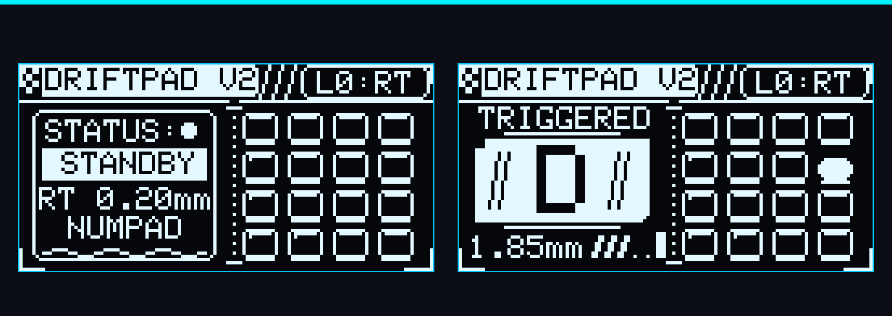

# DriftPad Studio · RP2040 Hall-Effect Macropad Suite

<div align="center">



[-c51a4a?style=flat-square&logo=raspberrypi&logoColor=white)](https://www.raspberrypi.com/documentation/microcontrollers/rp2040.html)
[](docs/hardware.md)
[](src/components/OledCanvas.tsx)
[](package.json)
[](firmware/)
[](src/services/serialService.ts)

**A high-precision analog macropad configurator, DSP simulator, and dual-core firmware suite for the 16-key Raspberry Pi Pico Hall-effect macropad.**

[Features](#features) • [Hardware Pinout](#hardware-pinout) • [OLED Widgets](#monochrome-oled-widgets) • [Calibration](#hall-effect-calibration) • [Quickstart](#quickstart) • [Serial Protocol](#serial-protocol)

</div>

---

## 2D Chassis Architecture

```
┌────────────────────────────────────────────────────────────────────────┐
│                        DRIFTPAD · RP2040                               │
│                   16-KEY HALL EFFECT CHASSIS                           │
├──────────────────────────────────────┬─────────────────────────────────┤
│    0.96" 128×64 MONOCHROME OLED      │     KNURLED ROTARY DIAL         │
│  ┌────────────────────────────────┐  │            ╭─────╮              │
│  │ COCKPIT · APM · 4×4 MAP · ART  │  │         ╭──╯  ▲  ╰──╮           │
│  │ 2.45mm [██████████░░░] ACTUATED│  │        │   ( 120° )  │  24 Steps│
│  │ ACT: 1.20mm  RT: 0.20mm (ON)   │  │         ╰──╮  ▼  ╭──╯  Push-SW │
│  └────────────────────────────────┘  │            ╰─────╯              │
├──────────────────────────────────────┴─────────────────────────────────┤
│                    4×4 TACTILE KEY MATRIX                              │
│       ┌─────────┐      ┌─────────┐      ┌─────────┐      ┌─────────┐   │
│       │ Key #0  │      │ Key #1  │      │ Key #2  │      │ Key #3  │   │
│       │  [ESC]  │      │   [7]   │      │   [8]   │      │   [9]   │   │
│       │  0.00mm │      │  0.00mm │      │  0.00mm │      │  0.00mm │   │
│       ├─────────┤      ├─────────┤      ├─────────┤      ├─────────┤   │
│       │ Key #4  │      │ Key #5  │      │ Key #6  │      │ Key #7  │   │
│       │  [TAB]  │      │   [4]   │      │   [5]·  │      │   [6]   │   │
│       │  0.00mm │      │  0.00mm │      │  0.00mm │      │  0.00mm │   │
│       ├─────────┤      ├─────────┤      ├─────────┤      ├─────────┤   │
│       │ Key #8  │      │ Key #9  │      │ Key #10 │      │ Key #11 │   │
│       │ [BKSP]  │      │   [1]   │      │   [2]   │      │   [3]   │   │
│       │  0.00mm │      │  0.00mm │      │  0.00mm │      │  0.00mm │   │
│       ├─────────┤      ├─────────┤      ├─────────┤      ├─────────┤   │
│       │ Key #12 │      │ Key #13 │      │ Key #14 │      │ Key #15 │   │
│       │  [SPC]  │      │   [.]   │      │   [0]   │      │  [ENT]  │   │
│       │  0.00mm │      │  0.00mm │      │  0.00mm │      │  0.00mm │   │
│       └─────────┘      └─────────┘      └─────────┘      └─────────┘   │
└────────────────────────────────────────────────────────────────────────┘
```

---

## Features

### 1. Hall-Effect Analog Sensing & Rapid Trigger DSP
- **Continuous 0.00mm–4.00mm Travel Tracking**: Eliminates conventional mechanical contact debounce.
- **Velocity-Adaptive IIR Low-Pass Filter**: Filters resting magnet thermal jitter at rest; bypasses filtering dynamically during rapid key strokes.
- **Dynamic Rapid Trigger**: Keys reset immediately when ascending by the sensitivity threshold (e.g. `0.15mm`), enabling lightning-fast double taps and stutter-free inputs.
- **Per-Key Safety Actuation Overrides**: Configure destructive keys (e.g., Delete, Kill Server) to require deep intentional strokes (e.g. `3.50mm`) while keeping navigation switches hair-trigger light.

### 2. Monochrome White 0.96" OLED Suite (SSD1306)
- **Monochrome Hardware Fidelity**: High-contrast pure white pixels on deep black (`#04070a`) matching physical 1-color SSD1306 displays.
- **Modular Widgets**:
  - **Cockpit**: Real-time travel meter, active keycode, rotary mode, and actuation gate line.
  - **APM Speedometer**: Live Actions-Per-Minute gauge, Clicks-Per-Second indicator, and total session keystroke counter.
  - **4×4 Sensor Map**: Miniature matrix visualizer displaying simultaneous analog travel depth across all 16 keys.
  - **Focus Timer**: High-contrast Pomodoro clock with live progress tracking.
  - **Screensavers**: 3D Starfield, Matrix Rain, DVD Bounce, Sine Wave, and 128×64 checkerboard diagnostic.
- **Integrated Pixel Art Editor**: 32×32 drawing canvas with Pencil, Eraser, Invert, Clear tools, and one-click **C Byte Array Export** (`const uint8_t PROGMEM ...`) for Arduino and Pico SDK.

### 3. Automated Hall-Sensor ADC Calibration Wizard
- **Phase 1 (Zero-Point Baseline)**: Multi-sample resting baseline detection to eliminate magnet height tolerances.
- **Phase 2 (Bottom-Out Sweep)**: Live 4×4 key matrix visual sweep measuring maximum magnetic flux per switch.
- **Phase 3 (Deadzone & Verification)**: $0.05\,\text{mm}$ safety deadzone padding and resolution metrics (counts/mm) with automatic hardware EEPROM sync.

### 4. Interactive GPIO Pinout Configurator
- Visual pin assignment and conflict detection for Raspberry Pi Pico GPIOs.
- Custom wiring support for MUX ADC input, 4-bit channel addresses, OLED I2C bus pins, and rotary encoder channels.
- Instant `#define pinout_config.h` header generation and full dual-core `.ino` firmware generator.

---

## Hardware Pinout

| Component | RP2040 Pin | Function | Notes |
| :--- | :--- | :--- | :--- |
| **Multiplexer Signal** | `GP26` (ADC0) | Analog Input | 12-bit ADC (0–4095 counts), 0–3.3V |
| **Multiplexer S0** | `GP14` | Address Bit 0 | CD74HC4067 channel selector |
| **Multiplexer S1** | `GP15` | Address Bit 1 | CD74HC4067 channel selector |
| **Multiplexer S2** | `GP16` | Address Bit 2 | CD74HC4067 channel selector |
| **Multiplexer S3** | `GP17` | Address Bit 3 | CD74HC4067 channel selector |
| **OLED SDA** | `GP0` | I2C0 SDA | Fast-mode I2C @ 400kHz |
| **OLED SCL** | `GP1` | I2C0 SCL | Fast-mode I2C @ 400kHz |
| **Encoder Channel A**| `GP20` | Rotary Phase A | Quadrature input with internal pull-up |
| **Encoder Channel B**| `GP21` | Rotary Phase B | Quadrature input with internal pull-up |
| **Encoder Push SW**  | `GP2` | Tactile Switch | Active LOW push-to-click |

---

## Dual-Core Firmware Architecture

```
                    ┌──────────────────────────────────────┐
                    │       Raspberry Pi Pico (RP2040)     │
                    └──────────────────┬───────────────────┘
                                       │
            ┌──────────────────────────┴──────────────────────────┐
            ▼                                                     ▼
┌──────────────────────────────┐              ┌──────────────────────────────┐
│            CORE 0            │              │            CORE 1            │
│  - 1,000Hz MUX ADC Scan      │              │  - 30 FPS Lock-Free Loop     │
│  - Velocity-Adaptive IIR DSP │──[FIFO Msg]─▶│  - SSD1306 128×64 Monochrome │
│  - Continuous Rapid Trigger  │              │  - 400kHz Fast-mode I2C      │
│  - USB Keyboard HID Report   │              │  - Screensaver / Widgets     │
└──────────────────────────────┘              └──────────────────────────────┘
```

---

## Quickstart

### Prerequisites
- Node.js 18+
- Modern Chromium browser (Chrome, Edge, Opera) for WebSerial USB communication.

### Run Studio Configurator
```bash
git clone https://github.com/The-Osprey1/DriftPad.git
cd DriftPad
npm install
npm run dev
```

Navigate to `http://localhost:3000` to access the live macropad configurator.

---

## Serial Protocol Reference

The DriftPad firmware communicates over USB Serial at **115200 baud (8N1)**:

| Command | Arguments | Description | Example |
| :--- | :--- | :--- | :--- |
| `GET_CONFIG` | None | Returns full JSON config packet | `GET_CONFIG` |
| `SET_ACTUATION` | `<mm>` | Sets global actuation threshold | `SET_ACTUATION 1.20` |
| `SET_RT_SENS` | `<mm>` | Sets Rapid Trigger sensitivity | `SET_RT_SENS 0.20` |
| `SET_RT` | `0` or `1` | Enables or disables Rapid Trigger | `SET_RT 1` |
| `CAL_SAMPLE_REST` | None | Triggers zero-point baseline scan | `CAL_SAMPLE_REST` |
| `CAL_SET` | `<idx> <rest> <max>` | Sets calibration values for a key | `CAL_SET 5 1945 3420` |
| `CAL_COMMIT` | None | Flashes calibration table to EEPROM | `CAL_COMMIT` |
| `OLED_TEST` | None | Displays 128×64 checkerboard test | `OLED_TEST` |
| `SLEEP` / `WAKE` | None | Controls OLED low-power sleep | `SLEEP` |

---

## License

MIT © [Devyn Fidel](https://github.com/The-Osprey1) & DriftPad Contributors.
