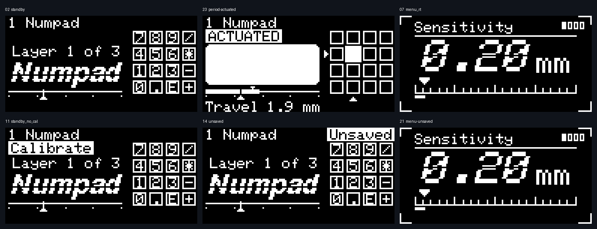

**DriftPad display review — September 30, 2026**

The split key view is a useful foundation: the focused key, travel gauge, layer header and
4×4 map have stable positions. The next improvements should make important state visible
and navigation predictable. Keep the current visual direction and manual page selection.

This review uses 29 fresh 128×64 frames from the production `oled.cpp` renderer and the real
Adafruit GFX library. The host supplies synthetic inputs, a clock and a stub panel. Numpad
legends and values are fixtures rather than the connected pad's configuration. Each numbered
PNG is native resolution; the contact sheets enlarge pixels by four without smoothing.
The captures were inspected, including native frames for the main readability findings.
[Capture metadata](captures.json) records the renderer hash and frame hashes.

**Manual control requirement and completed correction**

Standby stays on the layer/key view. Pressing the encoder button selects sensitivity,
actuation, Rapid Trigger on/off, layer, then the key view. Rotation adjusts the selected
setting and opens its screen if needed. A selected settings page stays selected. Idle
does not start the screensaver or sleep. Explicit display commands remain available.
Key travel and map state update within the key view; they do not navigate away from a menu.
The startup animation still finishes normally before the selected operational screen appears.

The old auto-return countdown graphic was left behind after timed menu dismissal was
removed. It has now been removed too. The OLED tests passed (29 tests), including button
navigation, stationary page selection, zero rotary delta, inactivity and the absent countdown.
The firmware build succeeded. The resulting development image was flashed to COM3 and its
firmware identity, saved-settings source/sequence and complete configuration were checked
after restart. Configuration was preserved, settings remained clean at sequence 14,
calibration remained missing, output remained disabled, and OLED_SCAN reported `0x3C`.
[Device update evidence](device-update.json) records the exact UF2 hash. This confirms the
update and communication; the physical screen and encoder feel were not observed remotely.

**Captured flow**

| Step | Screens | Assessment |
|---|---|---|
| 1. Start | [01 title](01-boot-title.png) | Clear identity and firmware version; missing calibration has a prompt. Only one animation instant is shown; intro timing and interruption have separate automated coverage. |
| 2. Rest | [02 standby](02-standby.png) | Stable layer and useful map. Layer identity is repeated in three places while actuation and RT values are absent. |
| 3. Move and press | [03 travel](03-travelling.png), [04 multiple pressed keys](04-actuated.png), [05 ENT](05-actuated_ent.png), [06 RT release guide](06-rt_backing_off.png) | Travel, filled state and row/column focus pointers provide distinct cues. A selected period label becomes invisible; see isolated reproduction below. |
| 4. Tune settings | [07 sensitivity](07-menu_rt.png), [08 actuation](08-menu_actuation.png), [09 RT toggle](09-menu_toggle.png), [10 layer](10-menu_layer.png) | Large values and units fit. Four page indicators give position but do not explain turn versus press, the return to the key view, or the slider endpoints. |
| 5. Understand blocked output | [11 calibration missing](11-standby_no_cal.png), [12 output off](12-travelling_output_off.png), [13 calibrating](13-calibrating.png), [20 missing calibration in menu](20-menu-uncalibrated.png) | The key view explains why typing is blocked. The settings view loses that explanation; calibration also lacks progress or the next action. |
| 6. Edit and save | [14 unsaved](14-unsaved.png), [15 saved](15-saved.png), [16 notice expired](16-saved-expired.png), [21 unsaved in menu](21-menu-unsaved.png) | Save feedback is clear on the key view. It is absent from the screen where the encoder changes settings. |
| 7. Wait on a selected page | [18 menu entry](18-menu-at-entry.png), [19 ten seconds later](19-menu-after-10s.png) | The selected page persists, with no countdown. Automated checks also cover every page and idle beyond the old sleep timeout. |
| 8. Stress labels | [17 WWWW](17-wide-label.png), [22 period travelling](22-period-travelling.png), [23 period actuated](23-period-actuated.png) | The wide four-character legend fits. A period appears as a small line at the bottom when travelling, then disappears completely when actuated. |
| 9. Explicit screensaver | [24 starfield](24-screensaver-starfield.png), [25 plasma](25-screensaver-plasma.png), [26 tesseract](26-screensaver-tesseract.png), [27 horizon](27-screensaver-horizon.png), [28 magnetic pulse](28-screensaver-magnetic-pulse.png), [29 lava](29-screensaver-lava.png) | All six render distinct visuals. Keep activation explicit and offer a quiet display preference; screenshots cannot establish comfort, real brightness or panel wear. |

[Full screen gallery](overview.png), [feedback and navigation gallery](feedback-and-navigation.png),
[screensaver gallery](screensavers.png).

**Improvements in order**

1. **Make every supported key legend visible in both states (P1).** The isolated period fixture
   is enough to demonstrate a real rendering defect: the actuated card is entirely blank inside.
   Check glyph bounds and the scratch region in `drawKeyBox`/`drawStyledText`, then use a plain
   rendering fallback for punctuation or any label whose styled result loses its distinguishing
   pixels. Keep the card dimensions and focus pointers. Acceptance: printable supported labels,
   including `.`, `-`, `/`, `+`, lowercase descenders and four-character labels, remain identifiable
   when released and pressed; no label touches the status chip, map or travel scale.

2. **Show persistence and output state while editing (P1).** Frames 14 versus 21 show that
   `Unsaved` disappears on the tuning screen. Frames 11 versus 20 show the same loss for
   `Calibrate`. `renderFullScreen` notices saves in menu mode, but the menu does not draw either
   status. Reserve a consistent small status area across views. It should show whether changes
   are pending, saved, or failed, and explain blocked output without taking over the selected page.
   Encoder autosave already waits for the encoder to rest and key state to become quiet; browser
   edits can keep that save pending. Feedback should distinguish these cases. Acceptance: change a
   setting, observe pending and saved feedback without leaving it; force a failed save and keep the
   pending/error state visible; blocked output remains visible in every menu.

3. **Expose sensor faults on the OLED (P1, source-confirmed gap).** There is no fault-state capture
   because the current display snapshot carries no fault mask. `displayBuildSnapshot` zeros travel
   and pressed state for faulted keys, while INFO exposes the fault list. The OLED therefore cannot
   distinguish a faulted channel from a resting key. Add a fault badge and distinct map treatment,
   plus an explicitly selected diagnostics page showing affected positions and calibration state.
   Use a stable warning inside the selected view, with an explicit recovery indication. Acceptance:
   a latched rail fault releases output, identifies the affected key, and clears the warning only
   after the existing recovery rules succeed. Plausible ADC values alone must not be labelled
   proof that a Hall sensor is installed or functioning.

4. **Explain the controls and provide a quick return (P2).** Frames 07–10 have room below the
   settings content but no instruction. Add a concise turn/press hint, and consider holding the
   button to return directly to the key view. A short press should continue to advance settings.
   Long press is a proposal, not an implemented gesture; the current encoder reports a click on
   press, so distinct short/long handling needs deliberate implementation. Acceptance: every
   setting can be reached, changed and exited without a timed transition or accidental change.

5. **Use the standby area for a useful summary (P2).** Frame 02 repeats the layer in the header,
   `Layer 1 of 3`, and the large name. Keep the stable header and recognizable layer name, then
   test a compact actuation/RT summary in the remaining space. It should make the current tuning
   visible at a glance without automatic page changes. Validate actual pixels before accepting
   the revised composition; do not shrink essential text to force extra information into it.

6. **Offer plain critical lettering and reduced motion (P2).** The slit and slant are part of the
   current identity, but they cut through parameter digits and key labels as well as the title.
   The period defect is concrete; a broader readability problem is a risk requiring user testing.
   Offer clean digits/legends and reduced transitions while keeping the title style available.
   The 9×9 map cells and small captions are useful secondary cues, but the large key and explicit
   text should carry the primary meaning. Accept the result at native resolution and then at the
   real desk viewing distance, including punctuation and similar glyphs.

**Useful feature candidates**

| Order | Addition | Benefit and acceptance condition |
|---|---|---|
| Next | Manually selected sensor diagnostics | Fault positions, calibrated-key count, selected-channel raw values and measured signal stability help assembly and repair. Separate ADC counts from calibrated millimetres; do not infer sensor presence from one sample. |
| Next | Calibration progress on the OLED | Mirror the existing guided calibration: release keys, press the requested key, completed count, and an actionable failure reason. Entry is explicit; output stays blocked until calibration succeeds. |
| Next | Consistent pending/saved/error status | Lets the user trust encoder edits while remaining on their chosen page. Show errors until resolved or explicitly acknowledged. |
| Later | Brightness and quiet-display preferences | Adjust brightness and choose plain text/reduced motion. Screensaver and sleep stay explicitly selected; no default page cycling or idle takeover. |
| Later | Configurable layer names | Replace generic names with the user's purpose. Measure and safely abbreviate names in the header, with the full name on the selected layer page. |
| Later | Optional boot animation length | A short or disabled intro helps repeated testing. Preserve the existing calibrated-key skip protection; unconnected sensor noise must never dismiss it. |
| Later | Safe output control with a visible state | A deliberate control can enable/disable keyboard output and explain rejection when calibration is invalid. It must never bypass the calibration or sensor-fault protections. |

Start with the legend defect and status continuity, then diagnostics and calibration progress.
Additional decorative animations have less value while these gaps remain.

**Evidence and limits**

The relevant production code is [oled.cpp](../../../firmware/src/oled.cpp),
[display_publish.cpp](../../../firmware/src/display_publish.cpp),
[display_link.h](../../../firmware/include/display_link.h),
[main.cpp](../../../firmware/src/main.cpp), and [encoder.cpp](../../../firmware/src/encoder.cpp).
The review-only [capture script](capture.py) and [fixture wrapper](renderer.cpp) run those drawing
functions without sending simulation or keyboard commands to the physical pad.

The page-control correction and countdown removal are implemented and flashed. The other
findings and feature candidates are recommendations. The connected pad has no Hall sensors
installed, so physical travel, sensor-fault recovery, calibration, RT accuracy and real key
acceptance are pending. OLED readability at desk distance, flicker, viewing angle, actual
brightness, encoder detents and switch bounce also need physical observation. High-contrast
framebuffers and passing pixel checks do not establish complete accessibility or hardware acceptance.
