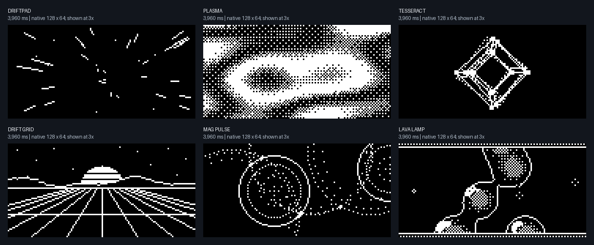
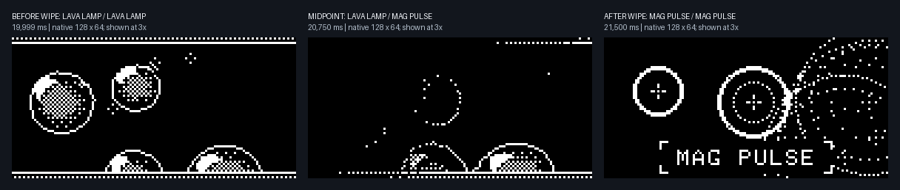

# Screensaver renderer previews

These captures run the current production OLED drawing code and shuffle Player with real Adafruit GFX and a stubbed panel. They show framebuffer pixels; they do not establish physical brightness, viewing angle, flicker, or device performance.

The six fixed-animation previews each show 120 frames at 33 ms per frame (3,960 ms elapsed), using seed `0xD12F7026`. The files numbered 01 through 06 preserve the native 128×64 pixels. Contact sheets enlarge pixels exactly three times for inspection.



The shuffle strip shows the outgoing animation at 19,999 ms, the wipe midpoint at 20,750 ms, and the completed wipe at 21,500 ms. The incoming label starts at the midpoint. The screen selection changes through a shuffled bag containing every animation once, with no adjacent repeats across bag boundaries.



[metadata.json](metadata.json) records the deterministic seed, source hashes, host-library build, timestamps, selected animations, label ages, and each native image hash. Reproduce these captures from the repository root with:

```powershell
& C:/Users/devyn/anaconda3/python.exe docs/reviews/screensaver-2026-09-30/capture.py
```

## Verification and connected-device check

[verification.json](verification.json) records a fresh clean firmware build and all 411 automated
tests passing with no failures, errors or skips. The browser checks inside those tests include
24 page checks, 66 module checks, and 351 fake-versus-firmware protocol comparisons. This was a
diagnostic run against the current uncommitted working tree, rather than release qualification.

[device-update.json](device-update.json) records the checked image flashed to the connected pad,
unchanged configuration before and after the update and display actions, and live applied-state
readbacks. The first shuffle round was Plasma, Drift grid, Starfield, Tesseract, Lava lamp,
Magnetic pulse. The next round began with Plasma, avoiding an adjacent repeat at the boundary.
Polling did not wake playback. The display core reported dimming at 180.02 seconds; restarting
shuffle restored full levels. Fixed playback, resuming the selection, Stop, and Display off were
also confirmed, including starting playback during the preceding test pattern's hold.

The pad was left in normal screen mode, with full panel levels restored. Its saved settings remained clean in
slot B at sequence 14; calibration remains missing and keyboard output disabled. The only
hardware wired for this check was the OLED. No physical Hall-key or rotary-input
acceptance was performed, and the OLED's actual appearance was not observed remotely.

With repeated INFO queries while shuffling, the scan-rate report was 998 Hz. TIMING recorded a
worst scan gap of 2,787 microseconds and 458 missed deadlines over about 185 seconds. These
measurements include serial polling; they do not establish full-board input latency or a strict
1,000-microsecond maximum gap. The raw timing record is retained in the device report.
